<div align="center">
  
# ⚡ NanoMatch-OME
**Ultra-Low-Latency C++20 Order Matching Engine with `io_uring` & Lock-Free Concurrency**

[](https://isocpp.org/)
[](https://kernel.dk/io_uring.pdf)
[](https://cmake.org/)
[](https://en.cppreference.com/w/cpp/atomic)
[](https://github.com/google/googletest)

> **NanoMatch-OME is a deterministic, sub-microsecond C++ Order Matching Engine architected for modern electronic exchanges and High-Frequency Trading (HFT) infrastructure.** 
> It eliminates OS context-switch penalties, mutex contention, and dynamic heap allocations on the hot path by combining **Linux `io_uring` asynchronous networking**, **cache-aligned Lock-Free SPSC Ring Buffers**, **O(1) Slab Memory Pooling**, and a **Price-Time Priority (FIFO) Limit Order Book**.

---

## 🚀 The Core Innovation: "Zero-Allocation, Zero-Lock Hot Path"

Standard multithreaded order matching engines suffer from tail-latency spikes ($p99.9$) caused by kernel syscall overhead (`epoll`/`recv`), mutex lock contention between I/O and matching threads, and non-deterministic `malloc`/`new` heap fragmentation.

**NanoMatch-OME eliminates all three bottlenecks by design:**

1. **Asynchronous Kernel-Bypass I/O (`src/io/`):** Replaces traditional blocking sockets with Linux `io_uring` submission/completion queues (`uring_receiver.hpp` & `uring_sender.hpp`) and zero-copy binary wire decoding (`wire_protocol.hpp` & `decoder.hpp`).
2. **Wait-Free Thread Handoff (`src/spsc/`):** Decouples network ingestion, core order matching, and execution broadcasting via cache-line padded (`alignas(64)`) Single-Producer Single-Consumer (`spsc_queue.hpp`) ring buffers using `std::memory_order_acquire/release` semantics.
3. **Deterministic Memory Arena (`src/core/`):** Pre-allocates contiguous `Order` objects inside a fixed-capacity slab pool (`order_pool.hpp`), guaranteeing $O(1)$ allocation/deallocation with zero heap fragmentation during peak market volatility.

---

## ⚡ System Architecture & Hot-Path Pipeline

NanoMatch-OME is structured as a staged, lock-free pipeline where each stage operates on isolated CPU cores with zero shared-memory mutexes.

```mermaid
flowchart LR
    classDef net fill:#0f172a,stroke:#38bdf8,color:#fff,rx:8px
    classDef io fill:#1e3a8a,stroke:#60a5fa,color:#fff,rx:8px
    classDef spsc fill:#b91c1c,stroke:#fca5a5,color:#fff,rx:8px
    classDef core fill:#047857,stroke:#34d399,color:#fff,rx:8px
    classDef mem fill:#6d28d9,stroke:#c4b5fd,color:#fff,rx:8px

    subgraph "External Market"
        Clients["🌐 Trading Clients\n(TCP / Binary Order Stream)"]:::net
    end

    subgraph "Stage 1: Async Ingress Layer (src/io/)"
        RxUring["📥 io_uring Receiver\n(uring_receiver.hpp)\nSQE / CQE Zero-Syscall Polling"]:::io
        Decoder["🔍 Wire Protocol Decoder\n(wire_protocol.hpp / decoder.hpp)\nZero-Copy Binary Deserialization"]:::io
    end

    subgraph "Lock-Free IPC"
        InboundQ[["⚡ Inbound SPSC Queue\n(spsc_queue.hpp)\nCache-Aligned Ring Buffer"]]:::spsc
        OutboundQ[["⚡ Outbound SPSC Queue\n(spsc_queue.hpp)\nExecution Report Stream"]]:::spsc
    end

    subgraph "Stage 2: Deterministic Matching Core (Single-Threaded Hot Path)"
        Engine["🧠 Matching Engine\n(matching_engine.hpp)\nPrice-Time Priority (FIFO) Logic"]:::core
        LOB["📊 Limit Order Book (LOB)\n(order_book.hpp)\nO(1) Best Bid/Ask & Intrusive Lists"]:::core
        Pool[("🧱 Pre-Allocated Order Pool\n(order_pool.hpp / order.hpp)\nO(1) Slab Arena • Zero Heap Alloc")]:::mem
    end

    subgraph "Stage 3: Async Egress Layer (src/io/)"
        TxUring["📤 io_uring Sender\n(uring_sender.hpp)\nAsync Trade & Ack Broadcast"]:::io
    end

    %% Pipeline Flow
    Clients ==>|Binary Wire Packets| RxUring
    RxUring --> Decoder
    Decoder ==>|std::memory_order_release| InboundQ
    InboundQ ==>|std::memory_order_acquire| Engine

    Engine <-->|Match / Insert / Cancel| LOB
    LOB <-->|Acquire / Release Slot| Pool

    Engine ==>|Trade Fills & Order Acks| OutboundQ
    OutboundQ ==>|Drain Batch| TxUring
    TxUring ==>|Execution Reports| Clients
```



### 1. High-Speed Binary Wire Protocol & `io_uring` Layer (`src/io/`)
- **Packed Binary Protocol (`wire_protocol.hpp` & `decoder.hpp`):** Processes fixed-layout binary messages (`NewOrder`, `CancelOrder`, `ModifyOrder`, `ExecutionReport`) without string parsing or serialization overhead.
- **Linux `io_uring` Engine (`uring_receiver.hpp` & `uring_sender.hpp`):** Batches socket reads and writes via kernel ring buffers, drastically reducing user-to-kernel space transitions.

### 2. Lock-Free SPSC Concurrency (`src/spsc/spsc_queue.hpp`)
- **False-Sharing Prevention:** Head and tail atomic indices are aligned to 64-byte hardware cache lines to prevent L1/L2 cache-coherency invalidation storms across CPU cores.
- **Wait-Free Atomics:** Uses strict `acquire`/`release` memory barriers instead of heavy `seq_cst` locks.

### 3. Intrusive Limit Order Book & Slab Allocator (`src/lob/` & `src/core/`)
- **Deterministic Slab Pool (`order_pool.hpp` & `order.hpp`):** Eliminates `new`/`delete` latency jitter by recycling pre-allocated `Order` nodes in $O(1)$ time.
- **Price-Time Priority Matching (`order_book.hpp` & `matching_engine.hpp`):** Supports Limit, Market, and Cancel operations with $O(1)$ order lookup, immediate partial/full fill execution, and instantaneous top-of-book (BBO) updates.

---

## 📂 Repository Structure

```text
NanoMatch-OME/
├── src/
│   ├── core/
│   │   ├── order.hpp                 # Cache-aligned Order struct & intrusive pointers
│   │   └── order_pool.hpp            # O(1) pre-allocated slab memory pool
│   ├── io/
│   │   ├── wire_protocol.hpp         # Packed binary exchange message definitions
│   │   ├── decoder.hpp               # Zero-copy frame parser & validator
│   │   ├── uring_receiver.hpp        # Asynchronous io_uring network ingress
│   │   └── uring_sender.hpp          # Asynchronous io_uring execution egress
│   ├── lob/
│   │   └── order_book.hpp            # Price-Time priority Limit Order Book (Bid/Ask trees)
│   ├── matching/
│   │   └── matching_engine.hpp       # Core matching loop & trade fill generator
│   ├── spsc/
│   │   └── spsc_queue.hpp            # Lock-free Single-Producer Single-Consumer ring buffer
│   └── main.cpp                      # Engine bootstrap & thread orchestration
├── benchmarks/                       # High-precision latency & throughput micro-benchmarks
│   ├── bench_lob.cpp                 # Limit Order Book insertion/cancellation benchmarks
│   ├── bench_matching_engine.cpp     # End-to-end order matching throughput benchmarks
│   ├── bench_order_pool.cpp          # Slab pool vs. heap allocation latency comparison
│   └── bench_spsc_queue.cpp          # Lock-free queue handoff latency benchmarks
├── tests/                            # Comprehensive unit & integration test suite
│   ├── test_io_uring.cpp             # Async network I/O & wire protocol tests
│   ├── test_matching_engine.cpp      # FIFO matching, partial fills & edge-case tests
│   ├── test_order_book.cpp           # LOB depth, price priority & cancel tests
│   ├── test_order_pool.cpp           # Memory pool exhaustion & recycling tests
│   └── test_spsc_queue.cpp           # Concurrent producer-consumer stress tests
├── CMakeLists.txt                    # Root CMake configuration (C++20, -O3, liburing)
└── build.sh                          # Automated build, test & benchmark runner script
```

---

## 🛠️ Tech Stack & Systems Engineering Primitives

| Subsystem | Technology / Primitive | Engineering Purpose |
|---|---|---|
| **Core Language** | Modern C++20 (`-O3 -march=native`) | Zero-cost abstractions, constexpr evaluation & cache-friendly layout |
| **Network I/O** | Linux `liburing` (`io_uring`) | Asynchronous submission/completion rings for high-throughput socket I/O |
| **Concurrency** | `std::atomic`, `alignas(64)` SPSC | Wait-free inter-thread communication without mutexes or futex syscalls |
| **Memory Model** | Custom Contiguous Slab Pool | Eliminates dynamic heap allocations (`malloc`/`free`) on the critical path |
| **Build & QA** | CMake, `build.sh`, Unit Tests & Benchmarks | Automated compilation, deterministic verification & latency profiling |

---

## ⚙️ Build, Test & Benchmark Workflow

NanoMatch-OME includes an automated `build.sh` pipeline and modular CMake targets for building the core engine, running unit tests, and executing hardware micro-benchmarks:

```bash
# 1. Make the build script executable and compile Release targets
chmod +x build.sh
./build.sh

# 2. Run the verification test suite
ctest --test-dir build --output-on-failure

# 3. Execute hardware micro-benchmarks (Latency & Throughput)
./build/benchmarks/bench_spsc_queue
./build/benchmarks/bench_order_pool
./build/benchmarks/bench_lob
./build/benchmarks/bench_matching_engine
```

---

> ⚠️ **Notice for Recruiters & Placement Officers:** 
> This repository is the original, independent systems engineering work of **Gaurang Ranjan Singh**. Please verify original authorship by checking the **Commit History**, which demonstrates continuous development across the `io_uring`, lock-free concurrency, slab memory pool, and Limit Order Book subsystems.

</div>

---
*Engineered for Deterministic Sub-Microsecond Execution. Built for Modern Markets.*
